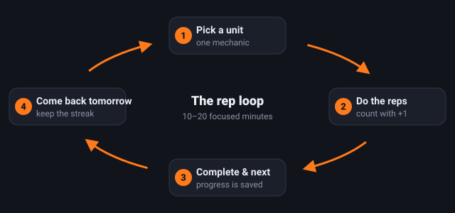

# Why reps work

Mechanics are built by **many short, focused attempts**, not by hoping they show up in ranked. Every unit in RL Reps gives you one mechanic, a clear goal, and a rep target.

# The loop

1. Open **Free Play** (or a custom training pack if the unit suggests one).
2. Read the unit's goal and cues.
3. Do the reps. Use the **+1 rep** counter on the drill page to keep count.
4. Hit **Complete & next** when you reach the target — even if most reps were misses.
5. Stop after one or two units. Come back tomorrow.

> A rep counts when you *attempted the mechanic properly*, not only when it worked. Clean attempts build the habit; results follow.

# Reading the visuals

Most units have a **looping clip** and a **step-by-step picture**. In the clips, the numbered list in the corner lights up to show which step the car is on. Click any clip to replay it from the start. They're simplified drawings to show the *shape* of each move, so match the timing to what you feel in game.

# Ground rules

- **Slow is fine.** Accuracy first, speed later.
- **One focus per rep.** If the cue is "tilt back early," think only about that.
- **Short sessions.** 10–20 focused minutes beat an hour of autopilot.
