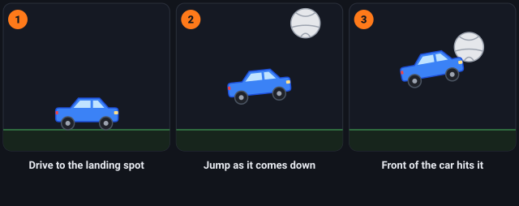

# Goal

Meet the ball cleanly in the air right after it bounces, using a single jump. This trains your timing and your read of the ball's height.

# Setup

Free Play. Let the ball drop and bounce once or twice near you.

# Cues

- Drive **toward the spot the ball will land**, not toward the ball.
- Jump **as the ball starts to come down** from its bounce.
- Hold jump for full height; let go once you feel the car rise.
- Hit the ball with the **front of the car**, aiming roughly at either goal.

# A rep counts when…

You jumped on purpose and tried to meet the ball in the air. Touch or no touch, it counts.

# Level up

Once 15 of 20 reps connect, try adding a small amount of boost during the jump.
