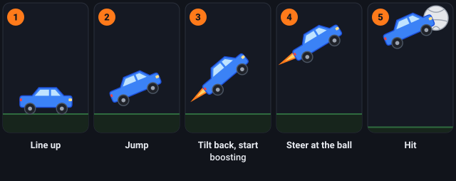

# Goal

Lift off, point your nose at the ball, and boost into it — your first real aerial.

# Setup

Free Play. Pop the ball up with a jump-hit or let it bounce high, then back off so you have room to approach.

# Cues

1. Line up so the ball is **in front of you**, not off to the side.
2. **Jump**, then immediately **tilt back** (pull the stick toward you) to point the nose up.
3. **Hold boost** and steer the nose at the ball.
4. Make small corrections. Big stick movements cause overshooting.

# Common misses

- **Going under the ball:** you jumped too early or tilted too far back.
- **Running out of boost:** start with at least half a tank.
- **Arriving late:** start the aerial sooner rather than waiting for the ball to come lower.

# A rep counts when…

You jumped, tilted, and boosted toward the ball on purpose.
