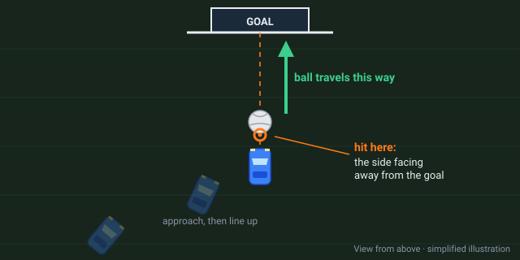

# Goal

Turn your aerial into a shot. Hit the ball with intent toward the net.

# Setup

Free Play, or any beginner **aerial training pack** from the in-game Training menu.

# Cues

- Before you jump, **look at where the goal is** relative to the ball.
- Aim to hit the **side of the ball facing away from the goal** — you push the ball the opposite way from where you hit it.
- Start the aerial early. You can always slow down; you can't speed up without boost.
- After the touch, **land on your wheels** and get back to the play.

# Training packs

:::packs
C7E0-9E0B-B739-A899 | Aerial Shots – Pass |  | Beginner-friendly | Forgiving, arcing passes: practice aiming your aerial at the net.
8B11-F7CF-A64C-229C | Aerial Shots – Pass 2 |  |  | More passing setups once the first pack is comfortable.
F269-B159-0BAC-AC2E | Double Jump Aerials | Doomsee | Diamond | Shots that need a double jump to reach. | featured
:::

# A rep counts when…

You attempted an aerial and made a deliberate aim choice before you jumped.

# You finished the course 🎉

Come back tomorrow and replay the units you found hardest, or start **Recovery & Movement** next.
