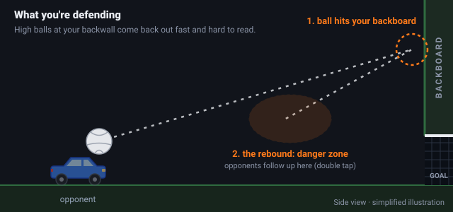

# What you're defending

When an opponent sends a high ball at your backwall, it rebounds back out into the space in front of your goal. That rebound is fast, comes off at angles that are hard to read, and is exactly where an attacker following up wants it. That's how a **double tap** works.

Backboard defense matters *because backboard offense works so well*. As you climb the ranks, opponents use your backboard more and more, so this habit pays off in almost every game.

# The big idea: awareness first

Every play in this course starts the same way: **notice early** that a ball is going to your backboard. A defender who sees it coming has time to get into position. One who reacts late is stuck reading a tricky rebound from the goal line.

# When to use the backboard (and when not to)

- **High balls toward your backwall:** if you have time, go early and meet it high, on the wall.
- **Low shots:** stay on the ground. Going up the wall for a low shot only makes you slower to reach the ball.
- **A teammate already in net:** rotate onto the backboard instead of stacking behind them (next unit).

# The plays you'll learn

1. **Backboard rotation:** get on the wall instead of crowding the net.
2. **Reading the rebound:** defend it from in front of the goal.
3. **The half-volley boom:** a big clear off the wall.
4. **Catch and dump:** control it into the corner when a boom would just give the ball back.
5. **Defending from the ground:** cut it off before it reaches the wall.

> Rule of thumb from the pros: **control first, boom second.** A huge clear is only good if your team can follow it up. Otherwise it just hands the ball back.
