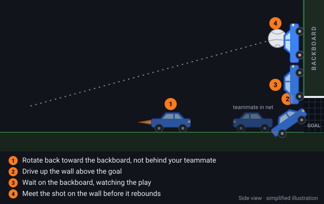

# Goal

When you rotate back on defense and a teammate is already in net, go **up onto the backboard** instead of parking right behind them.

# Why

- Two cars stacked in the goal **bump each other** and **double commit** on the same ball.
- From the wall you can **meet the shot before it rebounds**, and sometimes turn the save into an attack.

# Cues

- Rotate back on the **side of the goal**, not straight down the middle.
- Drive **up the wall above the goal**. Keep throttle on so you stay stuck to it.
- **Face the play** and wait. Don't drift down into your teammate.
- When the ball comes high, **throttle and boost** to meet it on the wall.

# Common mistakes

- Rotating **right in behind** the teammate already in net.
- **Hesitating** halfway, so you're neither on the wall nor in position.

# Setup

Free Play: hit the ball toward your own backwall from midfield, then race back and practice the rotation onto the wall. With a friend, take turns shooting at the backboard while the other rotates.

# A rep counts when…

You rotated back on the side, got onto the backboard and faced the play, whether or not you touched the ball.
