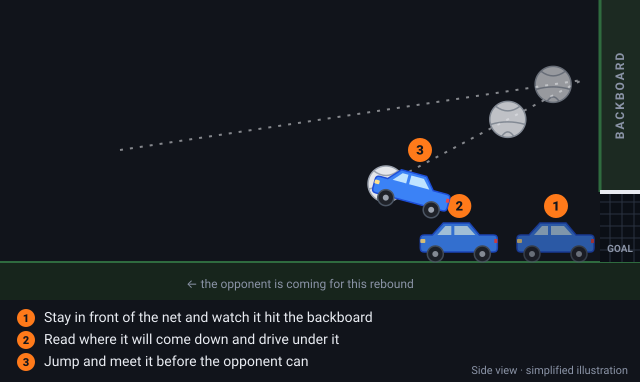

# Goal

Defend a backboard ball **from in front of your net**: watch it hit the wall, read where the rebound goes, and get there before the attacker.

# Cues

1. **Watch the ball onto the wall.** Don't guess or jump early. Wait until you see it hit.
2. **Read the rebound.** A ball that hits **high and fast** comes back out further. A **soft, low** hit drops close to the wall.
3. **Move under it** while it's still in the air. Get to the spot, don't chase the ball.
4. **Jump and meet it first** and send it away from the middle of the field.

> Reading every bounce is a core skill in Rocket League, not just on the backboard. The more reps you do here, the better your reads off walls and the floor get too.

# Common mistakes

- **Jumping before the ball hits the wall** and ending up underneath the rebound.
- **Clearing it into the middle**, which sets up the attacker. Aim for the sides.

# Setup

Custom Training → search for a **backboard reads** pack. A popular one is "Backboard Reads" by Rizzo (code `07E1-81BC-DD2E-BF8C`). Pack codes from older guides sometimes stop working. If a code doesn't load, search the pack name instead.

# A rep counts when…

You waited for the bounce, read it, and went for the rebound on purpose.
