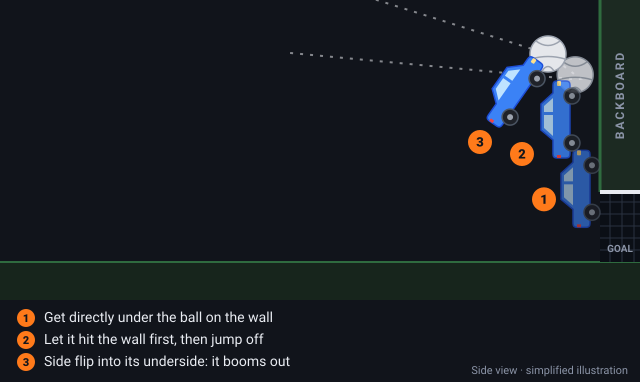

# Goal

Clear the ball **off your backboard** with a powerful half-volley: hit it just after it bounces off the wall so it booms out and away.

# When to use it

When your team is under pressure and **needs time** to rotate back and pick up boost. A big clear buys that time.

# Cues

1. Get **directly beneath the ball** on the wall.
2. Let it **hit the wall first**. The hit comes *just after* the bounce.
3. **Side flip** into the ball's **underside** (as seen from the wall). A side flip is the easiest option: the timing is more forgiving, and it sends the ball outward rather than straight at the ceiling.

> Your view on the wall is different from a normal half-volley on the ground. You'll need reps to relearn where "under the ball" is from up there.

# Common mistakes

- Using **ground half-volley instincts**, which send the ball forward along the wall instead of out and away.
- **Booming when your team can't follow up.** A clear that the opponents collect just restarts the pressure.

# Setup

Use the training packs below. In Free Play, you can also pop the ball onto your backwall and practice getting under it.

# Training packs

:::packs
F1D5-36FA-257C-80A8 | Backboard Clears | WayProtein |  | Clears off your backboard, made for the half-volley boom.
B1BB-45DA-0741-FB32 | Backboard Clears Exercise | Droogans | Diamond | More backboard clear reps once the first pack feels easy. | featured
:::

# A rep counts when…

You were on the wall under the ball, waited for the bounce, and attempted the side-flip clear.
