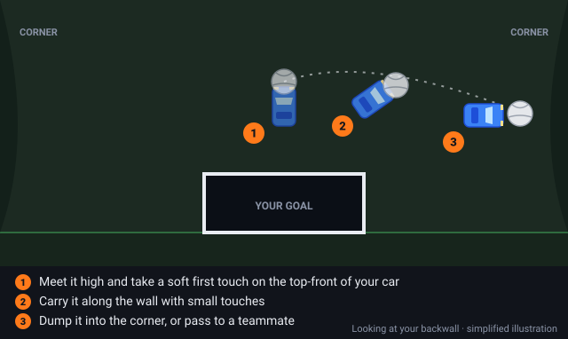

# Goal

Instead of booming it, **catch** the ball on your backboard and **carry it into the corner**, keeping possession and taking it away from the attackers.

# When to use it

- An opponent is **in the air waiting** for a follow-up.
- A boom would probably just be **intercepted**.
- Your team is positioned and boosted enough to **go on offense**.

This is "control first, boom second" in practice.

# Cues

1. Meet the ball **high** and take a **soft first touch** on the **top-front** of your car (the side facing the ceiling).
2. **Carry it along the wall** with one or two small follow-up touches toward the corner.
3. **Dump it** into the corner, pass to a teammate, or keep it for a 50/50.

# Common mistakes

- Trying it **too far from the corner**. You can only keep the ball on the wall for a short time, so the further the corner, the harder the carry.
- **Letting the ball drift off the wall.** Keep it tight to the wall.
- Trying it when an opponent is **already on the wall** with you.

# Setup

Free Play: pop the ball off your backwall and practice the soft first touch, then the carry. Start near the corner and work your way toward the middle of the goal.

# A rep counts when…

You tried a soft, controlled first touch on the wall and carried toward the corner, even if the ball fell off.
