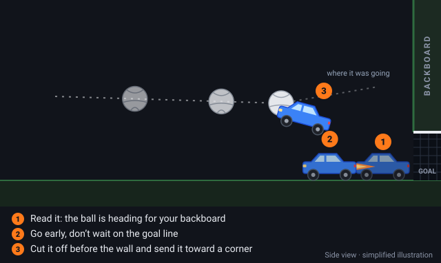

# Goal

When nobody is on your backboard, defend it **from the ground** by cutting the ball off **before** it reaches the wall.

# Cues

1. **Read it early:** the ball is heading for your backboard.
2. **Go early.** Leave the goal line and drive out to meet it.
3. **Cut it off before the wall** and send it toward a **corner**, not the middle.

# The other option: the late clear

You can also wait for the ball to bounce off the wall for maximum clearing power, jumping *before* the bounce and predicting its line to cut off any follow-up. It's much harder, though, and **very difficult from the goal line**. Get comfortable with the early cut first.

# When to stay in net

If a teammate is already playing wide or on the wall, the goalie usually **stays in net** and covers the rebound (unit 3).

# Common mistakes

- **Waiting on the goal line** for a ball you could have cut off early.
- **Clearing into the middle** of the field, which sets up the next attack.

# Setup

Custom Training → search for **backboard defense** or **backboard saves** packs, for example "Big D's Backboard D" (code `859E-5768-6175-235B`). If a code doesn't load, search the pack name.

# A rep counts when…

You read the ball early, left the goal line, and tried to cut it off before the wall toward a corner.

# You finished the course 🎉

Mix these into your warm-up and watch your replays: every time a ball reaches your backboard, ask whether you were on the wall, in front of the net, or cutting it off, and whether that was the right choice.
