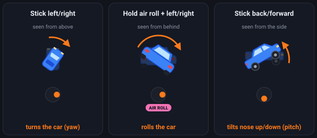

# What it is

In the air, your stick normally **turns** the car (left/right) and **tilts** the nose (back/forward). Hold the **air roll** button and left/right on the stick now **rolls** the car around instead. That's *free* air roll: you choose the direction with the stick.

# Why learn it

- **Aim:** the angle of your car decides where the ball goes. Rolling a little before you touch it changes the shot.
- **Recover:** roll your wheels toward the ground, wall or ceiling before you land.
- **Steer:** once you've rolled, pitching (stick back) moves the nose in a new direction. That's how good players change course mid-air.

# Set it up

- By default, air roll shares a button with **powerslide** (Square on PlayStation, X on Xbox). It works, but many players move **Air Roll** to **L1 / LB** in *Settings → Controls* so they can roll while boosting and jumping.
- Leave **Air Roll Left/Right** (directional air roll) unbound for now. This course is about *free* air roll.

> Change one binding, then stick with it for a week. Your hands need time to relearn.

# How this course works

Three drills, in order: **roll and stop level**, **stop on an angle**, then **roll to steer**. Each one has a real gameplay video, a "what to press" clip, a step-by-step picture, and training packs. Use Free Play for the first reps of every drill.
