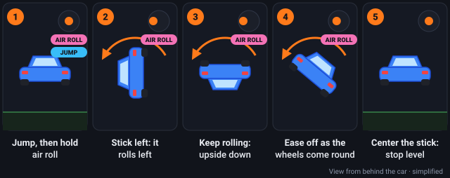

# Goal

Jump, roll the car a full turn with free air roll, and stop it level so you land cleanly on your wheels.

# Cues

1. **Jump** (hold it for more height and time).
2. **Hold air roll** and push the stick **left**. The car rolls left.
3. Keep rolling through upside down.
4. **Ease off** the stick as the wheels come back underneath you.
5. **Center the stick** and let go of air roll. Land on your wheels.

# Common mistakes

- **Letting go of air roll too early:** the stick goes back to turning the car and you spin sideways.
- **Holding the stick too long:** you over-rotate and land on your side. Start easing off earlier.
- **Only rolling one way:** do half your reps rolling **right**.

# Setup

Free Play, standing still. Then do it while driving, then off a double jump for more air time.

# Training packs

:::packs
E5A4-4C29-BBCF-1F9D | Freestyle Confidence Booster | PLEXICRAFT | Gold | Simple air-control shots that get you comfortable rolling before you touch the ball. | featured
5A4C-C195-64C7-557A | Sensitive Freestyle Training | SENS. FER | Platinum | Shots that need small, controlled rolls rather than big spins. | featured
:::

# A rep counts when…

You rolled a full turn with air roll held and tried to stop level before landing.
