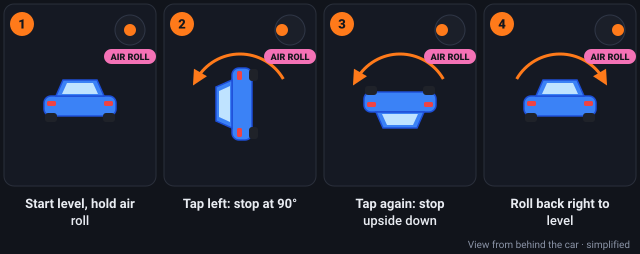

# Goal

Roll to an exact angle (sideways, upside down) and **hold it there**, then roll back to level.

# Cues

1. Jump and **hold air roll** the whole time.
2. **Short tap left:** stop at a quarter roll (90°).
3. **Center the stick:** the car keeps that angle.
4. Another tap: stop **upside down**.
5. Hold **right** to roll all the way back to level.

> Stopping is the skill. A roll you can't stop is a roll you can't aim with.

# Common mistakes

- **Taps that are too long:** the car overshoots. Make them shorter than feels right.
- **Fighting the overshoot:** a quick tap the other way stops the roll faster than waiting.
- **Watching the ball instead of your car:** for this drill, watch the car.

# Setup

Free Play. Use a double jump to give yourself time. Call an angle out loud ("90", "upside down") before each rep.

# Training packs

:::packs
5F4B-53F1-CC4C-A55E | Freestyle Angle Shots Vol.2 | Kdium | Platinum | Each shot wants your car at a different angle when you touch it. | featured
2D82-B92E-28AA-6B77 | Freestyle Goals 2 | Nasty Zjoon | Diamond | Harder angled touches once the first pack feels easy. | featured
:::

# A rep counts when…

You called an angle, rolled to it, and held it for a moment before rolling back.
