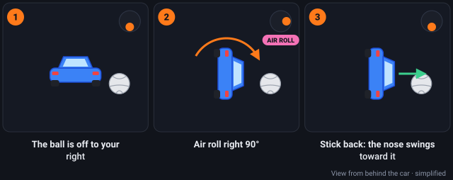

# Goal

Change direction in the air by **rolling first, then pitching**: roll 90° toward where you want to go, then pull the stick back so the nose swings that way.

# Cues

1. Take off toward the ball as normal.
2. The ball is off to one side. **Air roll** a quarter turn **toward it** (roof facing the ball).
3. Let go of air roll and pull the stick **back**. Because you're on your side, "nose up" now swings the nose **toward the ball**.
4. **Boost** into it.

> Pitch is the strongest way to turn in the air. Rolling first lets you point that strength in any direction.

# Common mistakes

- **Rolling the wrong way:** the roof should face the ball before you pitch.
- **Rolling too far:** past 90° and the pitch sends you down instead of across.
- **Forgetting to boost** after the turn, so you float past the ball.

# Setup

Free Play: pop the ball up to one side of you, take off, and steer to it with roll + pitch only.

# Training packs

:::packs
30EF-9E98-C844-E83D | Air Roll Aerials | WayProtein | Platinum | Aerials that need a roll before the touch. | featured
761E-8C2F-53CD-14F5 | Awkward Shooties | Markydooda | Champion | Off-angle balls that make you steer in the air. | featured
:::

# A rep counts when…

You rolled toward the ball, then pitched to steer, instead of only turning with the stick.

# You finished the course 🎉

You can roll, stop on an angle and steer with roll + pitch. Next up: **Shooting & Power Shooting**, then put both together in **Shooting with Free Air Roll**.

Come back tomorrow and do a short warm-up set of the drill that felt hardest. That's how these stick.
