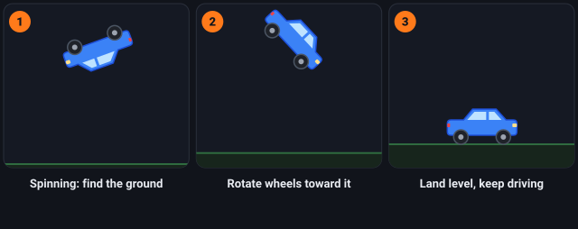

# Goal

Always land on your wheels after a jump, bump or aerial, so you can drive away instantly.

# Setup

Free Play. Drive up a wall and jump off at different heights, or jump off the ball at odd angles.

# Cues

- While falling, **look at the ground** (ball cam off can help here).
- Use **air roll** and pitch to get your wheels pointing down before you land.
- Aim to land with the car **level** and already **facing where you want to go**.

# A rep counts when…

You were in an awkward spot in the air and actively corrected to land on your wheels.
