# Goal

Always land on your wheels after a jump, bump or aerial, so you can drive away instantly.

# Setup

Free Play. Drive up a wall and jump off at different heights, or jump off the ball at odd angles.

# Cues

- While falling, **look at the ground** (ball cam off can help here).
- Use **air roll** and pitch to get your wheels pointing down before you land.
- Aim to land with the car **level** and already **facing where you want to go**.

# Training packs

There's no well-known pack made just for landings, so these build the **air roll control** that landings rely on. Make *landing on your wheels* an extra goal on every rep.

:::packs
30EF-9E98-C844-E83D | Air Roll Aerials | WayProtein |  | Get comfortable using air roll to orient the car in the air. | featured
84D2-072D-80CF-7D0D | Air Roll Shots | Yeeza |  | Air roll to line up shots, then land each one on your wheels. | featured
:::

# A rep counts when…

You were in an awkward spot in the air and actively corrected to land on your wheels.
