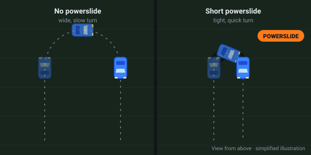

# Goal

Turn sharply without losing much speed by using powerslide.

# Setup

Free Play. Pick two points on the field (for example, the two goalposts on one side) and drive back and forth around them.

# Cues

- Hold **powerslide** only **briefly** during the turn — a tap, not a long drift.
- Let go of powerslide as soon as the car points where you want to go.
- Keep boosting or throttling through the turn to hold speed.

# Training packs

There's no widely used training pack for powerslide turns. **Free Play** (see Setup above) is the best place to drill them: set two targets and turn around them over and over.

# A rep counts when…

You completed a turn using a short powerslide on purpose.
