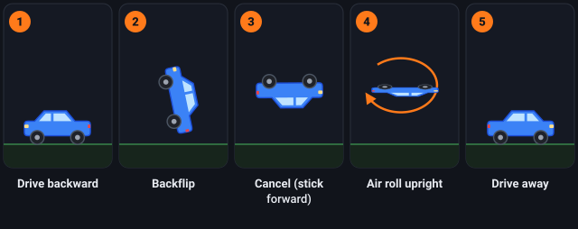

# Goal

Turn your car around 180° quickly while keeping momentum — the fastest way to recover when you're facing the wrong way.

# Cues

1. Drive **backward** (reverse).
2. **Jump**, then **flip backward** (second jump with the stick pulled back).
3. Partway through the flip, **push the stick forward** to cancel the flip, so the car stops rotating with its nose pointed up.
4. **Air roll** to flip the car upright and land on your wheels facing forward.

> Most people struggle with the cancel. Push forward firmly right after the backflip starts.

# How to practice

- **Reps 1–10:** slow and deliberate. Focus only on the backflip and the cancel.
- **Reps 11–30:** add the air roll and try to land driving forward.

# A rep counts when…

You did the backflip, attempted the cancel, and tried to roll upright.
