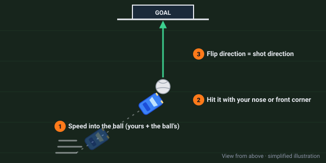

# Three things decide power

1. **Momentum:** your speed *plus* the ball's speed toward you. Driving into a ball that's rolling toward you hits harder than chasing one that's rolling away.
2. **Contact point:** the **nose** or a **front corner** hits hardest. Hitting with the side or roof of the car loses power.
3. **The flip:** a flip *into* the ball adds power, and its direction decides where the ball goes.

# Why it matters

A powerful shot gives the defender less time to react. A slow shot on target is easy to save; a fast one isn't.

# Accuracy first

Power is useless if it misses the net. The first drill is about **where** you hit the ball, the next three are about power:

1. **Ground shots:** aim by choosing which side of the ball you hit.
2. **The turn shot:** power with no flip, so you recover fast.
3. **The bounce power shot:** flip into the ball as it comes up off the ground.
4. **The aerial power shot:** flip into it in the air.

> Aim for a solid shot on goal, not the top corner. Pretend the goal is smaller than it is.
