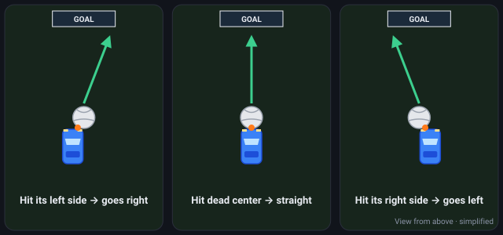

# Goal

Put ground shots on target by choosing **which side of the ball** your car hits.

# Cues

1. Before you reach the ball, decide where it should go.
2. Line up so you'll hit the **opposite side** of the ball: hit its left side to send it right.
3. **Throttle and boost through** it. Don't let off right before contact.
4. Watch where it goes and adjust the next rep.

# Common mistakes

- **Hitting dead center every time** and hoping it goes in.
- **Braking or letting off** just before you hit it. Keep driving through.
- **Last-second steering:** line up early, then hold your line.

# Setup

Free Play: roll the ball out from the middle and shoot from different angles. Then the packs below.

# Training packs

:::packs
6CF3-4C0B-32B4-1AC7 | Strength and Accuracy | Virge |  | From the video above: shots that reward power *and* placement.
4912-A5C9-9A56-555D | Shooting Consistency | WayProtein | Platinum | Simple ground shots to build a repeatable approach. | featured
:::

# A rep counts when…

You picked a target before the touch and lined up to hit the right side of the ball.
