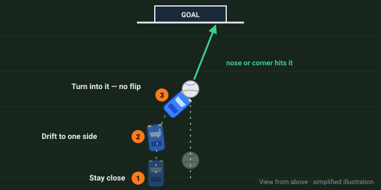

# Goal

Get a powerful shot **without flipping** by turning into a rolling ball and hitting it with your nose or corner.

# Cues

1. **Stay close** to the ball as you drive up the field.
2. When you have space, **drift to one side** of it to make room for a turn.
3. **Turn hard into it** and hit it with your **nose or front corner**.
4. You're still on the ground: **chase your shot**.

> Timing is everything. The tighter the turn at the right moment, the more power.

# Common mistakes

- **Turning too early:** you hit it with the side of the car and it dribbles away.
- **Drifting too far:** the ball gets away before you can turn back.
- **Flipping out of habit.** This shot works because you stay on the ground.

# Setup

Free Play: push the ball forward, drive beside it, and practice the turn. Then the packs.

# Training packs

:::packs
4D6A-C083-1FE7-08B7 | Power shot basic | Yuhi | Platinum | Simple power shots to learn where the car should hit the ball. | featured
7EB0-B25B-689D-3413 | Powershot Training | Iridium | Diamond | Faster, more varied power shots once the basics land. | featured
:::

# A rep counts when…

You drifted, turned into the ball and hit it with your nose or corner, without flipping.
