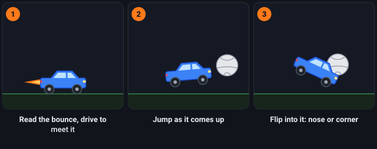

# Goal

Read where the ball will bounce, meet it right as it comes up, and **flip into it** with your nose or corner.

# Cues

1. **Read the bounce:** where will it land? This is the most important step.
2. Drive so you **arrive as it bounces up**, a little to one side of it.
3. **Quick jump** right as you meet it.
4. **Flip** (usually diagonally) so your **nose or corner** hits it. Your flip direction sets the shot direction.

# Common mistakes

- **Arriving early** and flipping under the ball.
- **Arriving late** and hitting it on the way down with no power.
- **Front-flipping straight on** every time: a diagonal flip with the corner usually hits harder.

# Setup

Free Play: pop the ball up gently and hit it right after the first bounce. Then the packs.

# Training packs

:::packs
C9E4-0F05-B71A-C322 | Powershot Practice | Skogur | Gold | Made for learning to hit the ball just after it touches the ground. | featured
7028-5E10-88EF-E83E | Powershots | Yeeza | Diamond | Harder bounce shots once you're getting power. | featured
:::

# A rep counts when…

You read the bounce, met it as it came up, and flipped into it with your nose or corner.
