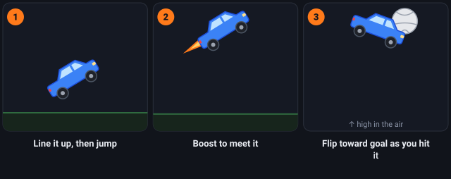

# Goal

Meet the ball in the air facing the goal and **flip into it** on contact for a fast aerial shot.

# Cues

1. Line up so your car will **face the goal** when you reach the ball.
2. Take off and **boost to meet it**, nose pointed at the ball.
3. **Flip toward the goal** right as you touch it, nose or corner first.

> Too early sends it toward a corner, too late sends it toward the backboard. Perfect timing gives you the whole goal.

# Common mistakes

- **Flipping before you reach the ball:** the flip carries you past it.
- **Facing the wrong way at contact:** the flip pushes the ball where your car points.
- **Not using enough boost** to actually meet it.

# Setup

Free Play: roll the ball up the side wall so it comes back out into the air, and try to meet it facing the goal.

# Training packs

:::packs
7753-F063-4B91-00C3 | Power Aerials | FlluuMP | Diamond | Aerial shots built for flipping into the ball. | featured
0390-AED7-109D-8770 | Powershots (super champion) | Ruzriel | Grand Champion | Optional challenge: very hard power shots for later. | featured
:::

# A rep counts when…

You met the ball facing the goal and flipped into it on contact.

# You finished the course 🎉

You can aim with contact, hit turn shots, bounce power shots and aerial power shots. Next: **Shooting with Free Air Roll** combines this with the roll control you learned.

Come back tomorrow and do a short warm-up set of the drill that felt hardest. That's how these stick.
