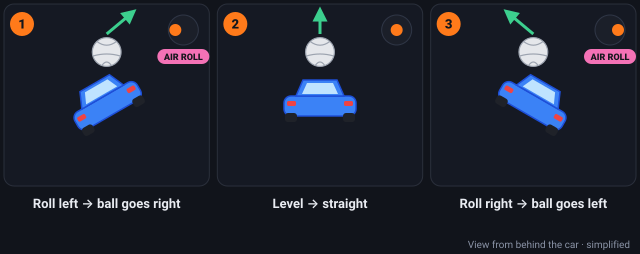

# The idea

Where the ball goes depends on the **angle of your car** when it touches the ball. Free air roll lets you change that angle right before contact.

- **Roll right** → the ball goes **left**. **Roll left** → it goes **right**.
- **A bigger roll** sends it further to that side. A slight tilt keeps it closer to the middle.

# When to use it

- To **aim** past a defender.
- For **more power**: a roll that lines up a front corner, then a dodge into the ball.
- To **redirect** a pass at the goal.

# When not to

- An **easy shot on an open net**: just hit it.
- **Dribbling** on the ground.
- **Showing off.** Too much roll makes you miss the ball entirely.

> Small rolls. Most good air roll shots use much less roll than you'd think.

# The drills

1. **The air roll shot:** small roll, then a diagonal dodge with the front corner.
2. **Aiming with roll:** choose how much to roll to put the ball left or right.
3. **Air roll redirects:** angle your car so a pass bounces off it into the net.
