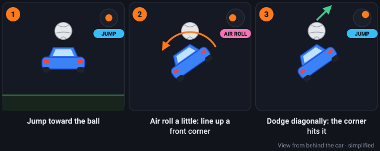

# Goal

Jump at the ball, **roll a little** to line up a front corner, then **dodge diagonally** so that corner hits the ball.

# Cues

1. **Jump** toward the ball.
2. **Air roll a little**, enough that a **front corner** lines up with the ball, not the flat nose.
3. **Dodge diagonally**, not straight forward, into the ball.
4. Land and follow your shot.

> What makes it an air roll *shot* is the dodge after the roll. That's where the power comes from.

# Common mistakes

- **Front-flipping** instead of a diagonal dodge.
- **Too much roll:** you hit it with the roof or miss.
- **Rolling too late:** start the roll as soon as you leave the ground.

# Setup

Free Play: pop the ball up and take it out of the air at about car height. Then the packs.

# Training packs

:::packs
84D2-072D-80CF-7D0D | Air Roll Shots | Yeeza |  | The classic pack for this exact mechanic. | featured
1C4E-D311-1506-B6C1 | Power shot + Air roll shot | Tama | Diamond | Mixes power shots with air roll shots. | featured
:::

# A rep counts when…

You rolled a little after the jump and dodged diagonally into the ball.
