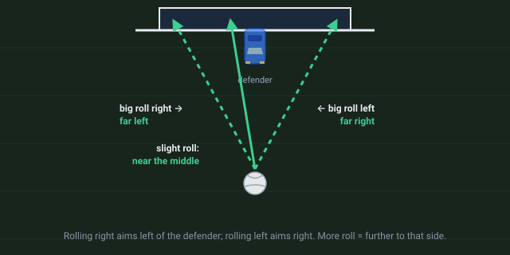

# Goal

Use **how much** you roll to choose where the ball goes: a slight roll for near the middle, a big roll for far to the side.

# Cues

1. Before you take off, pick a side: **left or right of the defender**.
2. Fly to the ball.
3. **Roll the opposite way** from the target: roll right to go left.
4. **Small roll** = small change, **big roll** = big change. Hold that angle through the touch.

# Common mistakes

- **Rolling as you hit it:** the angle is still changing at contact. Roll first, then hold it.
- **Always using a big roll.** Learn the small one; it's the one you'll use most.
- **Forgetting which way:** say it out loud: "roll right, ball left".

# Setup

Free Play: put the ball in the air near the goal and alternate targets: left post, middle, right post.

# Training packs

:::packs
A4D6-1260-C51D-4375 | Air Roll Shots | FLuuMP | Intermediate | Air roll shots at different angles, from the creator of the Air Roll Shots tutorial.
30EF-9E98-C844-E83D | Air Roll Aerials | WayProtein | Platinum | Aerials where the roll decides where it goes. | featured
:::

# A rep counts when…

You picked a target, rolled the opposite way by a planned amount, and held it through the touch.
