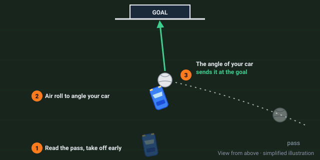

# Goal

Meet a pass in the air and use air roll to **angle your car** so the ball comes off it toward the goal.

# Cues

1. **Read the pass** and take off **early**. Redirects are about getting there.
2. **Air roll** so the side of your car facing the ball points the ball at the goal.
3. **Hold that angle** through the touch. You don't need to dodge; the ball's own speed does the work.

# Common mistakes

- **Taking off late** and chasing the ball across the goal.
- **Hitting it square** so it goes back where it came from.
- **Over-rolling:** small angle changes make big differences.

# Setup

Free Play: roll the ball into the corner so it comes back across the goal, then try to redirect it in. Then the packs.

# Training packs

:::packs
8D93-C997-0ACD-8416 | Aerial Shots – Redirects | Poquito |  | Passes across the goal for you to redirect in.
F22D-2A16-68BA-C6C7 | Redirects V1 | Ryuu Tsubasa | Champion | Faster, harder redirects. | featured
6614-D9A2-8D61-D6BC | Redirect Pack | James RL |  | From the video above.
:::

# A rep counts when…

You took off early, angled your car with air roll, and held it through the touch.

# You finished the course 🎉

You can hit air roll shots, aim with roll and redirect passes. That's the full Intermediate section. Keep mixing these drills into your warm-up.

Come back tomorrow and do a short warm-up set of the drill that felt hardest. That's how these stick.
